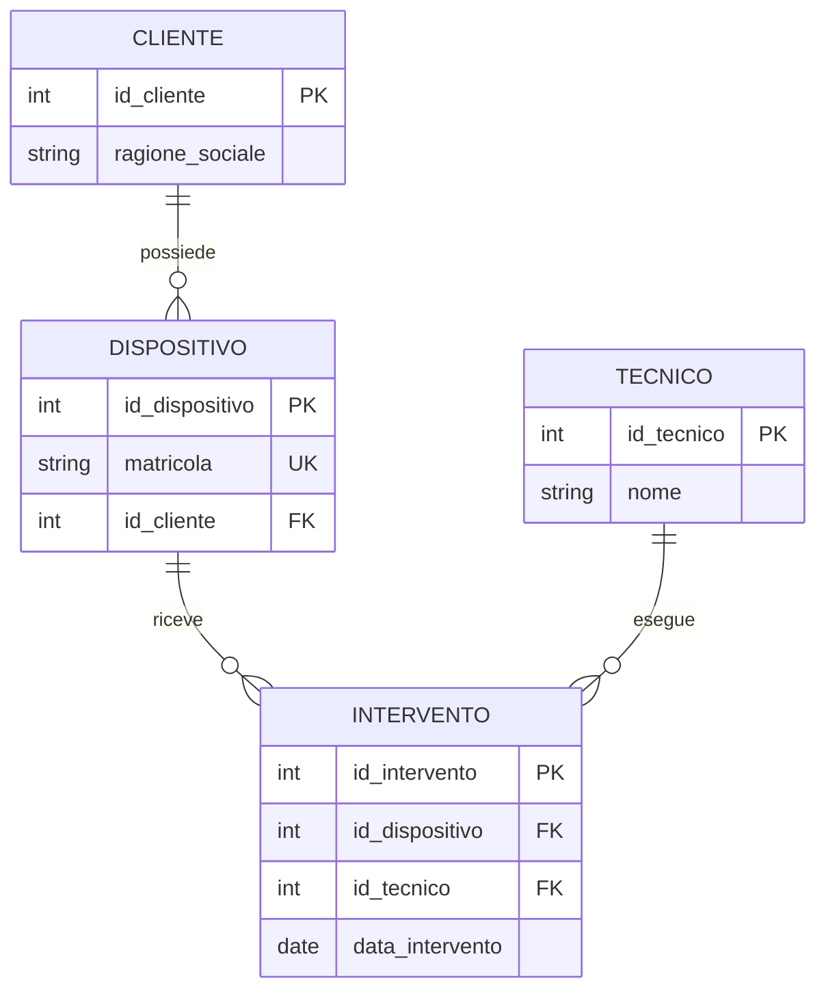

# Standard di documentazione e push — Basi di Dati

> **Regola permanente** per tutti i futuri appunti, esercizi e aggiornamenti della repository. Riferimento operativo: [GUIDA_AI.md](GUIDA_AI.md). Applicare questo standard anche se una nuova conversazione non contiene le chat precedenti.

## 1. Formati e collocazione
- **Markdown (.md)** per teoria, tabelle, formule, pseudocodice, esercizi, spiegazioni e valutazione delle risposte.
- **SQL (.sql)** per script SQL eseguibili; indicare sempre il DBMS/dialetto, quando necessario, e i prerequisiti.
- **Mermaid** incorporato nel Markdown per diagrammi E-R, flussi di progettazione, dipendenze, schemi e relazioni visuali. Preferire `erDiagram` per diagrammi entità-relazione e `flowchart` per processi. Se un costrutto E-R non è rappresentabile fedelmente in Mermaid (ad esempio alcune cardinalità min/max o vincoli), integrare una spiegazione formale esplicita o un SVG e NON nascondere la limitazione.
- **SVG/PNG** versionati nella repository solo quando Mermaid non basta; utilizzare collegamenti relativi nei documenti.
- Organizzare i contenuti in `teoria/`, `esercizi/`, `sql/`, `immagini/` secondo necessità, creando cartelle solo quando contengono file reali.

## 2. Requisiti degli appunti teorici
Ogni argomento deve includere, quando pertinente: definizione precisa, intuizione, **rappresentazione visuale contestuale**, esempio originale completo, tabelle di dati, passaggi di trasformazione, possibili errori, esercizio di applicazione, collegamento alla voce corrispondente di PROGRAMMA_CORSO.md. Per normalizzazione: esplicitare dipendenze funzionali, chiavi, anomalie e decomposizione. Per transazioni: stati, proprietà ACID e scenari. Per SQL: sintassi e risultato atteso verificabile.

## 3. Requisiti degli esercizi guidati
Per **ogni** esercizio registrare:
1. codice progressivo e argomento;
2. **DESCRIZIONE e consegna integrale**, inclusi dati, schemi e vincoli;
3. **diagramma E-R o altro diagramma**, tabella o schema pertinente alla consegna, non solo alla teoria;
4. **RISPOSTA EFFETTIVA DELLO STUDENTE**, distinguendola da eventuale esempio proposto dall'AI;
5. **ESITO**, errore e tentativi successivi, con correzione ragionata;
6. **SOLUZIONE EFFETTIVAMENTE RAGGIUNTA** (non inventata);
7. **COSA HO IMPARATO IN QUESTO ESERCIZIO**, solo competenze provate;
8. **ARGOMENTO D'ESAME** ed eventuale **ANALISI** (chiavi, cardinalità, complessità, output SQL, vincoli);
9. stato **COMPLETATO / APERTO**, prossimo passo e link a file correlati.

Se l'esercizio è ancora aperto, **non anticipare la soluzione** e non attribuire allo studente codice o risposte non prodotti.

## 4. Standard visuale di riferimento

### Diagramma E-R di esempio — azienda elettromedicali
*Scenario didattico originale, non parte ufficiale delle dispense Pegaso.*



Da leggere insieme alla descrizione testuale: un cliente può possedere zero o più dispositivi; ogni dispositivo appartiene a un cliente; un dispositivo può avere zero o più interventi; ogni intervento è svolto da un tecnico. Ipotesi semplificata del caso didattico.

### Esempio di tabella e query
| id_cliente | ragione_sociale |
|---:|---|
| 1 | Clinica Aurora |
| 2 | Centro Salute |

```sql
-- SQL standard di base; esempio illustrativo (non esercizio svolto).
SELECT id_cliente, ragione_sociale
FROM Cliente
ORDER BY id_cliente;
```

**Output atteso:** le due righe nella tabella sopra, ordinate per id_cliente.

## 5. Sincronizzazione GitHub obbligatoria
- Dopo **ogni esercizio completato** e dopo ogni lezione documentata, pubblicare il materiale aggiornato, non soltanto una sintesi breve.
- Aggiornare contestualmente **README.md** con modulo corrente, ultimo esercizio, stato dei concetti, errori da consolidare, prossimo esercizio e collegamenti ai nuovi file.
- Verificare i file pubblicati, il rendering dei diagrammi quando possibile e l'esito del commit prima di dichiarare un push riuscito.
- Conservare lo storico e non sovrascrivere soluzioni dello studente.
- Se non è possibile completare il push, segnalare esattamente cosa è rimasto locale o incompleto.

## 6. Fedeltà alle fonti e al percorso
Le dispense Pegaso già censite servono per delimitare il programma, ma i materiali nella repository devono essere **rielaborazioni originali**, senza riprodurne interi testi. Non inventare le lezioni 09, 14, 31 e 34 mancanti. Non segnare come acquisiti concetti per il solo fatto che compaiono nel programma. Procedere **una domanda alla volta**.
