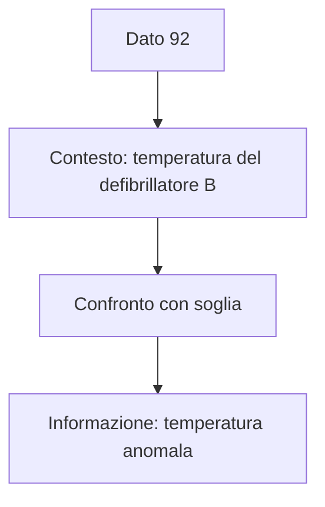

# E001 — Dato e informazione

Stato: completato il 14 ottobre 2026.

## Consegna 1
Il tecnico inserisce 85; il sistema mostra che la batteria del defibrillatore 12 ha una carica dell'85%.
Opzioni: A) 85 informazione, frase dato; B) 85 dato, frase informazione; C) entrambi informazioni; D) entrambi dati senza significato.

Risposta dello studente: A. Errata: risposta B, inversione concettuale delle definizioni.

## Consolidamento
Dati: defibrillatore A 37 °C; defibrillatore B 92 °C. Segnalazione: «Il defibrillatore B ha una temperatura anomala».
Opzioni: A) 92 è informazione completa; B) segnalazione è dato grezzo; C) 92 è dato, segnalazione è informazione interpretata; D) dato e informazione sono sinonimi.

Risposta dello studente: C. Corretta.

## Soluzione raggiunta
85 e 92 isolati sono dati. Il contesto consente di ricavarne informazioni; una soglia permette di stabilire un'anomalia. Errore iniziale corretto nel secondo tentativo.

## Cosa ho imparato in questo esercizio
Lo studente sa distinguere dato e informazione nel caso proposto. Da ripassare in altri contesti.

## Argomento d'esame
M1, dato e informazione. Nessuna query SQL o schema ER pertinente.

Prossimo esercizio: E002, sistema informativo e sistema informatico.