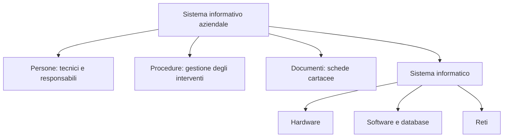

# E002 — Sistema informativo e sistema informatico

**Modulo:** M1 — Sistemi informativi e basi di dati (lezione 01)  
**Argomento d'esame:** distinzione tra sistema informativo e sistema informatico  
**Stato:** COMPLETATO — 14 ottobre 2026

## Descrizione e consegna integrale

Un'azienda gestisce gli interventi di manutenzione attraverso tecnici, procedure operative, schede cartacee e un database.

**Quale affermazione è corretta?**

- A. Il sistema informativo comprende esclusivamente i computer.
- B. Il sistema informatico comprende anche le procedure cartacee e l'organizzazione del personale.
- C. Il sistema informativo comprende persone, procedure e strumenti; quello informatico è la componente tecnologica.
- D. Un sistema informativo non può esistere senza computer.

## Risposta effettiva dello studente

**C**, al primo tentativo.

## Esito e correzione ragionata

**CORRETTA.** Il sistema informativo comprende persone, procedure, dati e strumenti usati per acquisire, elaborare e gestire informazioni; il sistema informatico è la componente tecnologica (hardware, software, reti, database). Il sistema informativo può anche esistere senza computer, per esempio attraverso procedure cartacee.

## Diagramma esplicativo

## Tabella di applicazione

| Elemento nel caso | Appartenenza |
|---|---|
| Tecnici e responsabili | Sistema informativo |
| Procedure operative | Sistema informativo |
| Schede cartacee | Sistema informativo |
| Computer, software e database | Sistema informatico e, quindi, sistema informativo |

## Soluzione effettivamente raggiunta

Lo studente ha selezionato autonomamente la risposta C. Non sono stati necessari indizi o ulteriori tentativi.

## Cosa ho imparato in questo esercizio

**Competenza provata:** riconoscere in un caso aziendale la distinzione tra l'insieme organizzativo che gestisce informazioni e la sua componente tecnologica. Non sono state ancora verificate competenze di progettazione di database o SQL.

## Analisi e prossimo passo

Si tratta di una distinzione concettuale: non sono richiesti uno schema E-R né query SQL. Prossimo esercizio: **E003 — ruolo del DBMS**. Riferimento: [PROGRAMMA_CORSO.md](../PROGRAMMA_CORSO.md), M1. Scenario didattico originale.
