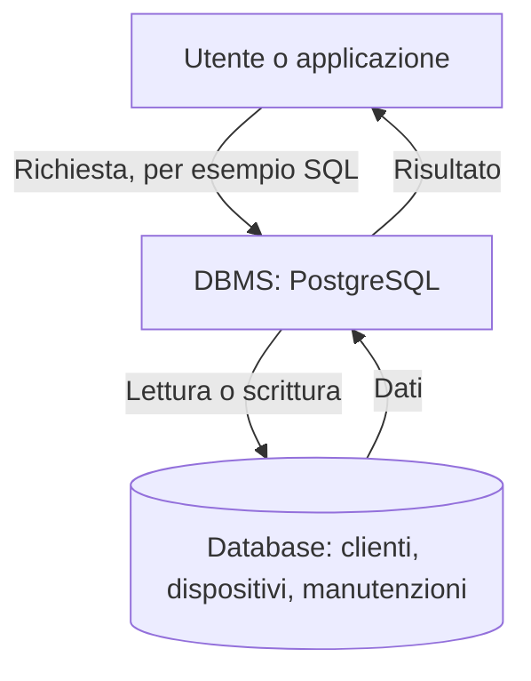

# E003 — Il ruolo del DBMS

**Modulo:** M1 — Sistemi informativi e basi di dati  
**Stato:** COMPLETATO — 14 ottobre 2026  
**Argomento d'esame:** database e DBMS

## Descrizione e consegna integrale

Un'azienda conserva migliaia di informazioni su clienti, dispositivi e manutenzioni in un database gestito tramite PostgreSQL.

**Quale affermazione è corretta?**

- A. PostgreSQL è il database stesso, cioè l'insieme dei dati archiviati.
- B. Il DBMS è il software che permette di gestire e interrogare il database.
- C. Un DBMS serve esclusivamente a memorizzare file di testo.
- D. Un database può essere consultato soltanto modificando manualmente i file che contengono i dati.

## Risposta effettiva dello studente

**B**, al primo tentativo.

## Esito e correzione ragionata

**CORRETTA.** Il database è una raccolta organizzata di dati; il DBMS è il software che consente di crearla, modificarla, interrogarla e amministrarla. PostgreSQL è un esempio di DBMS; SQL è il linguaggio utilizzabile per interagire con esso.

## Rappresentazione visuale

| Elemento | Ruolo |
|---|---|
| Applicazione | Formula una richiesta |
| PostgreSQL | DBMS che elabora la richiesta |
| Database aziendale | Contiene dati organizzati |
| SQL | Linguaggio per definire e interrogare dati |

## Soluzione effettivamente raggiunta

Lo studente ha selezionato autonomamente l'opzione B, senza errori né suggerimenti.

## Cosa ho imparato in questo esercizio

**Competenza dimostrata:** riconoscere il ruolo di un DBMS rispetto a un database nel caso proposto. Non è ancora stata provata l'abilità di scrivere istruzioni SQL.

## Analisi specifiche e prossimi passi

Esercizio concettuale: diagramma di funzionamento pertinente; schema E-R e codice SQL non richiesti. Prossimo esercizio: **E004 — schema e istanza**. Vedi [programma M1](../PROGRAMMA_CORSO.md).