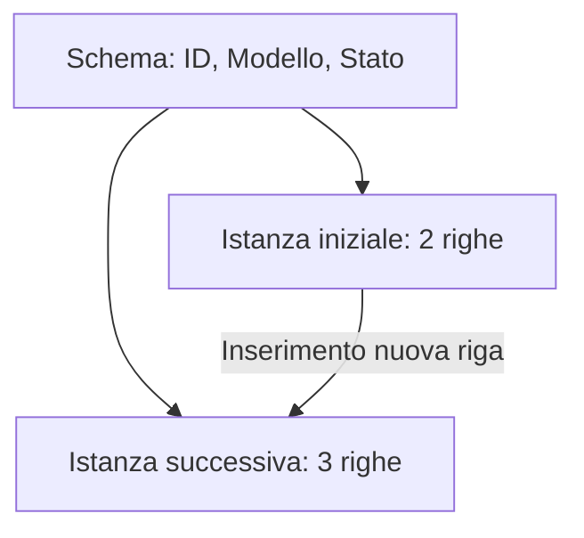

# E004 — Schema e istanza

**Modulo:** M1 — Sistemi informativi e basi di dati  
**Stato:** APERTO (14 ottobre 2026) — consolidamento richiesto  
**Argomento:** schema e istanza di database

## Consegna iniziale

Tabella DISPOSITIVI:

| ID | Modello | Stato |
|---|---|---|
| 1 | Defibrillatore A | Operativo |
| 2 | Ecografo B | In manutenzione |

Un tecnico aggiunge un nuovo defibrillatore alla tabella DISPOSITIVI, senza modificarne le colonne.

**Che cosa cambia?**

- A. Cambia lo schema, ma non l'istanza.
- B. Cambia l'istanza, ma non lo schema.
- C. Cambiano necessariamente sia lo schema sia l'istanza.
- D. Non cambia né lo schema né l'istanza.

## Risposta effettiva dello studente

**D**. Esito **errato**, tipo di errore: **concettuale**. Risposta corretta: **B**.

## Correzione e analisi

Lo **schema** descrive la struttura (colonne ID, Modello, Stato e relativi tipi); l'**istanza** descrive i valori memorizzati in un certo momento. L'aggiunta di una riga cambia l'istanza, non lo schema.

### Dopo l'inserimento

| ID | Modello | Stato |
|---|---|---|
| 1 | Defibrillatore A | Operativo |
| 2 | Ecografo B | In manutenzione |
| 3 | Defibrillatore C | Operativo |

## Soluzione effettivamente raggiunta e competenze

Prima risposta errata, correzione spiegata. **Non è ancora dimostrato** il superamento della distinzione schema/istanza: attendere il risultato del consolidamento. Non attribuire una risposta al consolidamento prima che sia ricevuta.

## Prossimo passo

Consolidamento di **E004**: valutare una modifica delle colonne invece delle righe. Non iniziare E005 finché la distinzione non è verificata. Schema E-R e SQL non sono necessari per questo esercizio introduttivo. Riferimento: [PROGRAMMA_CORSO.md](../PROGRAMMA_CORSO.md), M1.
