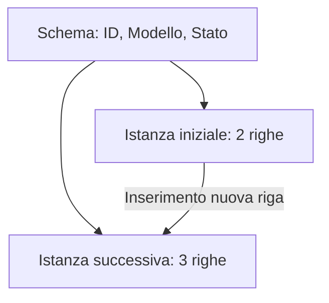

# E004 — Schema e istanza

**Modulo:** M1 — Sistemi informativi e basi di dati  
**Stato:** COMPLETATO (15 ottobre 2026) — risposta corretta al secondo consolidamento  
**Argomento:** schema e istanza di database

## Consegna iniziale

Tabella DISPOSITIVI:

| ID | Modello | Stato |
|---|---|---|
| 1 | Defibrillatore A | Operativo |
| 2 | Ecografo B | In manutenzione |

Un tecnico aggiunge un nuovo defibrillatore alla tabella DISPOSITIVI, senza modificarne le colonne.

**Che cosa cambia?**

- A. Cambia lo schema, ma non l'istanza.
- B. Cambia l'istanza, ma non lo schema.
- C. Cambiano necessariamente sia lo schema sia l'istanza.
- D. Non cambia né lo schema né l'istanza.

## Risposta effettiva dello studente

**D**. Esito **errato**, tipo di errore: **concettuale**. Risposta corretta: **B**.

## Correzione e analisi

Lo **schema** descrive la struttura (colonne ID, Modello, Stato e relativi tipi); l'**istanza** descrive i valori memorizzati in un certo momento. L'aggiunta di una riga cambia l'istanza, non lo schema.

### Dopo l'inserimento

| ID | Modello | Stato |
|---|---|---|
| 1 | Defibrillatore A | Operativo |
| 2 | Ecografo B | In manutenzione |
| 3 | Defibrillatore C | Operativo |

## Primo consolidamento — 15 ottobre 2026

**Consegna:** alla tabella DISPOSITIVI, composta dalle colonne ID, Modello e Stato e dalle due righe iniziali, viene aggiunta la colonna Data_Acquisto, senza inserire o eliminare righe.

**Opzioni presentate:**
- A. Cambia soltanto l'istanza.
- B. Non cambia né lo schema né l'istanza.
- C. Cambia lo schema della tabella.
- D. Viene necessariamente creato un nuovo database.

**Risposta effettiva dello studente:** A. **Errata (errore concettuale)**. Risposta attesa **C**: l'aggiunta di una colonna modifica la struttura, ossia lo schema. In senso rigoroso, la rappresentazione delle tuple dell'istanza cambia anch'essa per comprendere il nuovo attributo (ad esempio inizialmente NULL); il quesito distingue il tipo principale di operazione, non pretende che l'istanza sia letteralmente identica.

| ID | Modello | Stato | Data_Acquisto |
|---|---|---|---|
| 1 | Defibrillatore A | Operativo | NULL |
| 2 | Ecografo B | In manutenzione | NULL |

**Correzione spiegata:** schema = struttura; istanza = valori presenti. Aggiungere una colonna è un'operazione sullo schema, mentre aggiungere o modificare righe senza cambiare colonne opera sui dati dell'istanza.

## Secondo consolidamento — 15 ottobre 2026

**Consegna:** il tecnico modifica soltanto il valore Stato dell'Ecografo B da «In manutenzione» a «Operativo», senza cambiare colonne né numero di righe.

**Opzioni:** A. Soltanto schema; B. Soltanto istanza; C. Schema e istanza; D. Nessuno dei due.

**Risposta effettiva dello studente: B — CORRETTA.**

| ID | Modello | Stato prima | Stato dopo |
|---|---|---|---|
| 1 | Defibrillatore A | Operativo | Operativo |
| 2 | Ecografo B | In manutenzione | **Operativo** |

La struttura (ID, Modello, Stato) resta invariata; cambia un dato memorizzato: dunque cambia soltanto l'istanza.

## Soluzione effettivamente raggiunta e competenze

Prima risposta D errata e primo consolidamento A errato, con spiegazioni. Il secondo consolidamento B è corretto. **Dimostrato:** riconoscere autonomamente una modifica dell'istanza su valori di una riga senza modifica dello schema. **Da rivedere:** riconoscimento autonomo delle modifiche allo schema, dopo l'errore nel primo consolidamento. E004 chiuso, con richiamo programmato in esercizi successivi.

## Prossimo passo

Avviare [E005 — Livelli di rappresentazione](005-livelli-rappresentazione.md); riprendere anche la distinzione schema/istanza in un caso successivo. Schema E-R e SQL non sono necessari per questo esercizio introduttivo. Riferimento: [PROGRAMMA_CORSO.md](../PROGRAMMA_CORSO.md), M1.
