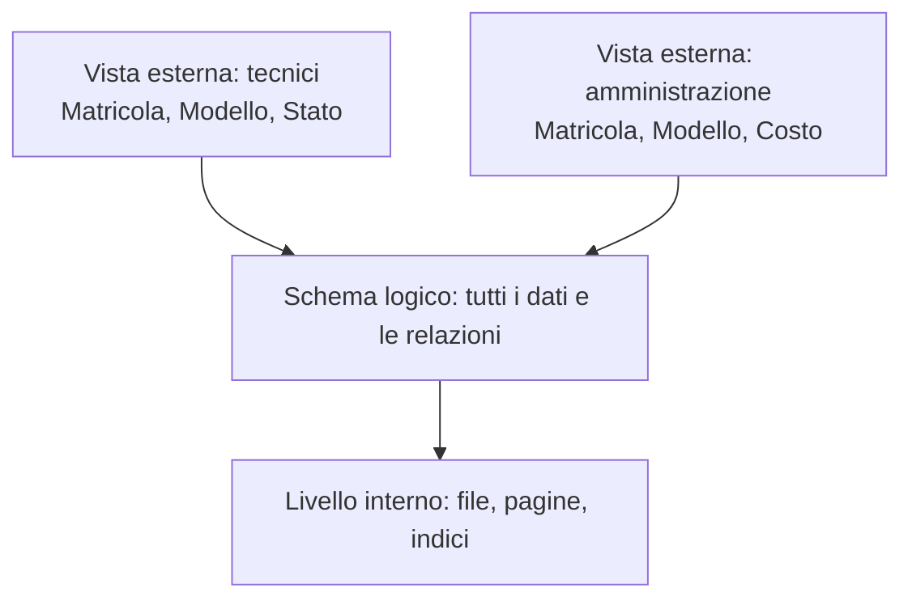

# E005 — Livelli di rappresentazione: vista esterna

**Modulo:** M1 — Sistemi informativi e basi di dati  
**Stato:** APERTO (15 ottobre 2026) — risposta in attesa  
**Argomento d'esame:** livelli di rappresentazione di una base di dati; livello esterno, logico (concettuale nell'architettura ANSI/SPARC) e interno.

## Descrizione e teoria minima
In un'azienda di dispositivi elettromedicali, l'applicazione per i tecnici visualizza soltanto matricola, modello e stato dei dispositivi. La base dati memorizza anche altre informazioni e usa un'organizzazione fisica sul disco che il tecnico non deve conoscere.

- **Livello esterno**: vista dei dati destinata a uno specifico utente/applicazione.
- **Livello logico/concettuale dell'architettura a tre livelli**: struttura complessiva dei dati e relazioni, indipendentemente dalla memorizzazione fisica.
- **Livello interno**: come i dati sono organizzati e memorizzati fisicamente.

### Esempio didattico: vista dei tecnici
| Matricola | Modello | Stato |
|---|---|---|
| EM-101 | Defibrillatore A | Operativo |
| EM-102 | Ecografo B | Manutenzione |

Non è richiesto codice SQL: l'esercizio serve a identificare il livello di rappresentazione.

## Consegna E005
Un tecnico può consultare soltanto matricola, modello e stato tramite la propria schermata, benché il database contenga molti altri dati. **Quale livello di rappresentazione descrive la schermata dedicata al tecnico?**

- **A.** Livello interno, perché mostra dati memorizzati su disco.
- **B.** Livello esterno, perché è una vista specifica destinata al tecnico.
- **C.** Livello logico complessivo, perché contiene necessariamente tutti i dati aziendali.
- **D.** Nessun livello: una schermata non può rappresentare dati di un database.

## Risposta effettiva dello studente
**Non ancora ricevuta.** Non attribuire esiti o competenze.

## Prossimo passo
Attendere la risposta a E005; correggerla, documentare soltanto l'effettivo risultato, poi aggiornare README. Richiamare il riconoscimento delle modifiche di schema nelle prossime applicazioni.

Riferimento: [Programma M1](../PROGRAMMA_CORSO.md).
