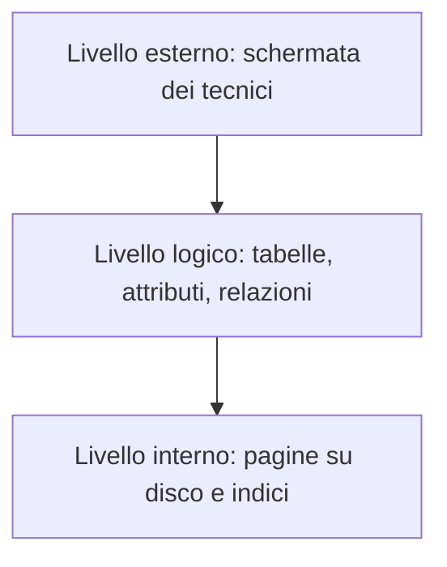

# E006 — Riconoscere il livello interno

**Modulo:** M1 — Sistemi informativi e basi di dati  
**Stato:** COMPLETATO (15 ottobre 2026), consolidamento corretto  
**Argomento d'esame:** livelli esterno, logico e interno.

## Descrizione e schema
L'azienda gestisce dispositivi elettromedicali. Il DBMS conserva lo schema dei dispositivi e organizza fisicamente i dati tramite pagine e indici.

### Tabella a livello logico (esempio)
| Matricola | Modello | Stato |
|---|---|---|
| EM-101 | Defibrillatore A | Operativo |
| EM-102 | Ecografo B | Manutenzione |

## Consegna
Il DBMS cambia il modo in cui memorizza la tabella DISPOSITIVI, creando un nuovo **indice** su disco per accelerare le ricerche. Le colonne e i dati visibili agli utenti restano invariati.

**Quale livello di rappresentazione viene modificato direttamente?**

- **A.** Livello esterno, perché cambia ciò che vede il tecnico.
- **B.** Livello logico, perché vengono aggiunte nuove colonne alla tabella.
- **C.** Livello interno, perché cambia l'organizzazione fisica dei dati.
- **D.** Tutti e tre necessariamente.

## Risposta effettiva dello studente
**Primo tentativo: B — errato (15 ottobre 2026).** Risposta corretta: C. Errore concettuale: confusione fra definizione logica di tabelle/attributi e organizzazione fisica attraverso indici. Non sono state aggiunte colonne.

## Consolidamento — 15 ottobre 2026
**Consegna:** il DBMS riorganizza le pagine dei dati su disco per migliorarne l'efficienza senza cambiare tabelle, colonne, righe o schermate.

**Opzioni:** A. Esterno; B. Logico; C. Interno; D. Tutti e tre.

**Risposta effettiva:** **C — corretta.**

### Correzione e analisi
La riorganizzazione delle pagine riguarda la rappresentazione fisica, quindi il livello interno. La struttura logica e le viste esterne rimangono inalterate.

### Soluzione effettivamente raggiunta — cosa ho imparato
Dopo un primo errore (B), lo studente ha identificato correttamente il livello interno in un caso di riorganizzazione fisica. **Competenze provate:** riconoscimento di un'operazione al livello interno dopo correzione. **Ancora da verificare:** riconoscimento di una modifica allo schema logico in un caso differente e distinzione autonoma completa dei tre livelli.

## Prossimo passo
[E007 — Modifica dello schema logico](007-modifica-schema-logico.md), risposta in attesa. Riferimento: [M1 nel programma](../PROGRAMMA_CORSO.md).

Riferimento: [M1 nel programma](../PROGRAMMA_CORSO.md).
