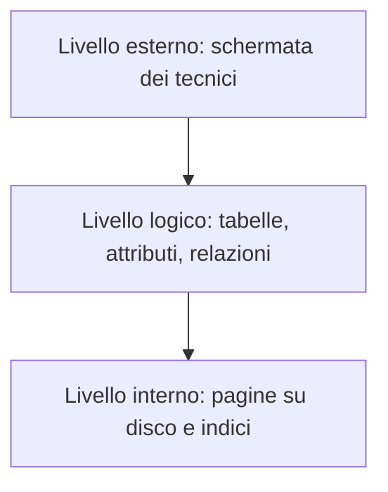

# E006 — Riconoscere il livello interno

**Modulo:** M1 — Sistemi informativi e basi di dati  
**Stato:** APERTO (15 ottobre 2026), primo tentativo errato; consolidamento in attesa  
**Argomento d'esame:** livelli esterno, logico e interno.

## Descrizione e schema
L'azienda gestisce dispositivi elettromedicali. Il DBMS conserva lo schema dei dispositivi e organizza fisicamente i dati tramite pagine e indici.

### Tabella a livello logico (esempio)
| Matricola | Modello | Stato |
|---|---|---|
| EM-101 | Defibrillatore A | Operativo |
| EM-102 | Ecografo B | Manutenzione |

## Consegna
Il DBMS cambia il modo in cui memorizza la tabella DISPOSITIVI, creando un nuovo **indice** su disco per accelerare le ricerche. Le colonne e i dati visibili agli utenti restano invariati.

**Quale livello di rappresentazione viene modificato direttamente?**

- **A.** Livello esterno, perché cambia ciò che vede il tecnico.
- **B.** Livello logico, perché vengono aggiunte nuove colonne alla tabella.
- **C.** Livello interno, perché cambia l'organizzazione fisica dei dati.
- **D.** Tutti e tre necessariamente.

## Risposta effettiva dello studente
**Primo tentativo: B — errato (15 ottobre 2026).** Risposta corretta: C. Errore concettuale: confusione fra definizione logica di tabelle/attributi e organizzazione fisica attraverso indici. Non sono state aggiunte colonne.

## Analisi e prossimi passi
Esercizio di riconoscimento del livello di rappresentazione. La verifica autonoma non è ancora svolta. Correggere solo dopo la risposta e aggiornare il README, una domanda alla volta.

Riferimento: [M1 nel programma](../PROGRAMMA_CORSO.md).
