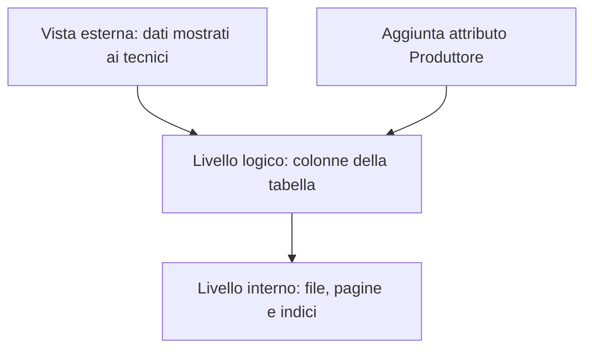

# E007 — Riconoscere una modifica dello schema logico

**Modulo:** M1 — Sistemi informativi e basi di dati  
**Stato:** APERTO (15 ottobre 2026) — risposta in attesa  
**Argomento d'esame:** livelli di rappresentazione, schema/istanza.

## Descrizione
La base dati dell'azienda elettromedicale contiene una tabella DISPOSITIVI con tre colonne.

| Matricola | Modello | Stato |
|---|---|---|
| EM-101 | Defibrillatore A | Operativo |
| EM-102 | Ecografo B | In manutenzione |

Per registrare il fabbricante di ciascun dispositivo, l'amministratore aggiunge alla definizione della tabella una colonna chiamata `Produttore`. La nuova colonna potrà poi essere valorizzata per le righe esistenti. Il metodo di memorizzazione fisica non è l'oggetto della modifica descritta.

### Diagramma dei livelli

### Struttura dopo la modifica
| Matricola | Modello | Stato | Produttore |
|---|---|---|---|
| EM-101 | Defibrillatore A | Operativo | da compilare |
| EM-102 | Ecografo B | In manutenzione | da compilare |

I valori «da compilare» sono segnaposto didattici, non una dichiarazione di valori già memorizzati; in un'implementazione concreta potrebbero inizialmente essere NULL se il vincolo lo consente.

## Consegna E007
L'amministratore aggiunge la colonna `Produttore` alla **struttura** della tabella DISPOSITIVI.

**Quale livello di rappresentazione viene modificato direttamente dalla scelta di aggiungere questo attributo?**

- A. Esterno, perché ogni tecnico vedrà necessariamente la nuova colonna.
- B. Interno, perché aggiungere un attributo significa soltanto riorganizzare le pagine su disco.
- C. Logico, perché cambia la struttura definita della tabella.
- D. Nessuno: cambiare una colonna modifica solo i valori di una riga.

## Risposta effettiva
**Non ancora ricevuta.** Nessuna competenza attribuita.

## Analisi e prossimo passo
Identificare la modifica allo schema logico, distinguendola dalla vista esterna e dall'eventuale adattamento fisico attuato dal DBMS. Valutare la risposta prima di procedere con un solo esercizio successivo.

Riferimento: [Programma M1](../PROGRAMMA_CORSO.md).
